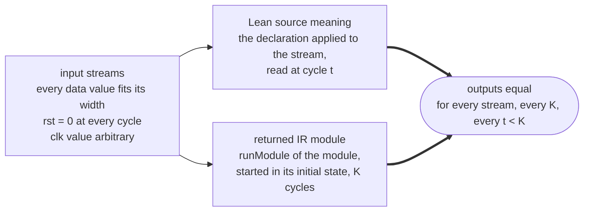
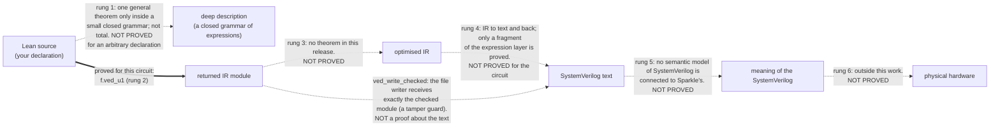
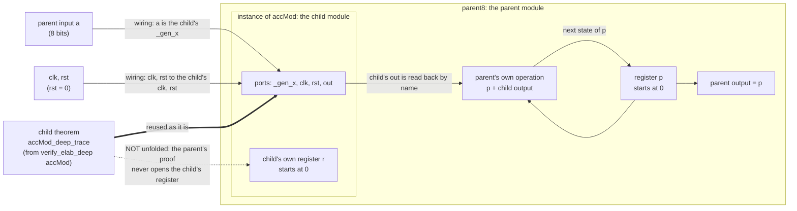
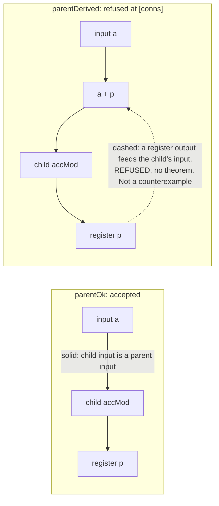

# Writing circuits whose proofs go through: a tutorial

This page is for a reader who has not seen this project before. It starts from a circuit
whose proof is built automatically, extends it twice, then shows a small change that makes
the automatic proof stop, and then shows which ways past that stop exist in the released
snapshot and which do not. Every example is a real file that you can run; every refusal is
pinned in the file, so every file exits 0.

Two sentences first, because they are easy to forget:

* **A refusal is not a proof that the circuit is wrong, and not a counterexample.** It only
  means that this checker built no theorem for this source. The circuit may be perfectly
  correct.
* **No style of writing guarantees success in general.** The examples show which small
  changes were observed to matter at the snapshot. Nothing here says that a circuit written
  in some style will be accepted, and a change in the checker can change any of the results.

Background pages: the [overview](README.md) (what the system builds and what it guarantees),
[PerCircuitVerification.md](PerCircuitVerification.md) (the routes), the tutorial chapter
[7c](../tutorial/md/Ch07c_VerifiedSynthesis.md) (the statement read clause by clause).

## Contents

1. [What you need and how to run the examples](#1-what-you-need-and-how-to-run-the-examples)
2. [What the theorem says](#2-what-the-theorem-says) (figure 1)
3. [Where the guarantee ends](#3-where-the-guarantee-ends) (figure 4)
4. [Example 1: a register that is proved](#4-example-1-a-register-that-is-proved) (figure 2)
5. [Example 2: extensions that are still proved](#5-example-2-extensions-that-are-still-proved)
6. [Example 3: a parent with a child module](#6-example-3-a-parent-with-a-child-module) (figure 3)
7. [Example 4: where the automatic proof stops](#7-example-4-where-the-automatic-proof-stops) (figure 5)
8. [Example 5: ways past the stop](#8-example-5-ways-past-the-stop)
9. [Your own lemma](#9-your-own-lemma)
10. [Summary table and checklist](#10-summary-table-and-checklist)

## 1. What you need and how to run the examples

Use the reader's checkout of the [snapshot box](README.md#snapshot-box) (the branch
`docs/research-release`, later its merge commit). The examples are in
`docs/research/examples/tutorial/`, one standalone Lean file each, run from the repository
root like [`examples/Delay8.lean`](examples/Delay8.lean). The verified tools are library
targets that are not in the default build, so build the target a file needs by name first:

```bash
git clone https://github.com/Verilean/sparkle && cd sparkle
git checkout docs/research-release
lake build Tools.VedU1Entry          # examples 1, 2 and 6
lake build Tools.VedU2HierRegEntry   # examples 3, 4 and 5
lake build Tools.VedU1PackedEntry    # example 5 (the packed route)
lake env lean docs/research/examples/tutorial/Ex1_Register.lean ; echo "exit $?"
```

Times. On a clean 4-vCPU runner, `Tools.VedU1Entry` took 60 s on top of the 83 s normal build,
and the `#ved_u1` of the 8-bit register took 2.2 s ([BuildAndCI.md](BuildAndCI.md); one run each).
Numbers marked **this machine** are from one run of this tutorial on a development machine
with the library already built (Lean 4.32.1); they are not clean-runner numbers. A whole file
takes about 12 s just to load the library, so the whole-file times below are mostly start-up.

| Item | Time |
|---|---|
| `lake build Tools.VedU1Entry` | 60 s on a clean 4-vCPU runner; 52 s this machine |
| `lake build Tools.VedU2HierRegEntry`, cold (its modules not built yet) | 6 min 53 s this machine, one run; not measured on a clean runner |
| `lake build Tools.VedU1PackedEntry` | 50 s this machine |

Every file also checks the axioms of every theorem it accepts: `#print axioms` under
`#guard_msgs`, with the expected line `[propext, Classical.choice, Quot.sound]`. These are the
three standard axioms; the entry's own report line (`VED U1 OK …: [Classical.choice,
Quot.sound, propext]`) lists the same three.

## 2. What the theorem says

**Figure 1. The same input stream goes into the source meaning and into the returned module.**



*Legend.* Thin solid arrow: the same data is given to both sides. Thick solid arrow: the
relation that the theorem proves. There is no dashed arrow in this figure: nothing in it is
unproved, but it is about the **returned IR module only** (figure 4 shows what lies beyond it).
*Caption.* The theorem compares two things computed from the same stream: what your Lean
function means, and what the module that synthesis just returned does when it is run by the
IR semantics. *Text alternative.* Input streams feed two boxes, "Lean source meaning" and
"returned IR module"; both outputs go into one box that says the outputs are equal for every
stream and every time.

**In plain words.** Take any input sequence whose values fit their bit widths, with the reset
line held at 0. Run the returned module for any number of cycles. At every cycle, the module's
outputs are exactly what your Lean function gives at that cycle. The right-hand side is
computed from your function itself, not from a copy. The theorem is built for each circuit and
checked by Lean's kernel each time.

**The Lean statement.** This is the statement at the snapshot (`Tools/VedU1Contract.lean`).
The clauses that matter for conditions:

```lean
-- Tools/VedU1Contract.lean:362  (reset and widths)
def InputsOk (c : Contract) (m : Module) (ins : Nat → String → Nat) : Prop :=
  (∀ t, ∀ p ∈ c.dataInputs, ins t p.name < 2 ^ declWidth m p.name) ∧
  (∀ t kr, c.clkRst = some kr → ins t kr.2 = 0)

-- Tools/VedU1Contract.lean:407  (the run, the initial state, the right-hand side)
def OutputsOn (c : Contract) (m : Module) (b : List Stmt) (f : c.table.Ty) : Prop :=
  ∀ ins, InputsOk c m ins → ∀ K, ∃ envs,
    runModule (declWidth m) b (seedFwd m K ins) K (st0 c m) (fun _ _ => 0) = some envs ∧
    ∀ t, t < K → ∀ o ∈ c.outputs, ∃ env, envs[t]? = some env ∧ env o.name = srcOf c f ins o.name t

-- Tools/VedU1Contract.lean:494
def U1Stmt (c : Contract) (m : Module) (f : c.table.Ty) : Prop :=
  CorrStmt c ∧ ShapeStmt c m ∧ WidthStmt c m ∧ OrderStmt m ∧ OutputsStmt c m f
```

Reading the conditions off these lines:

| Condition | Where it is in the statement |
|---|---|
| **Input width** | `ins t p.name < 2 ^ declWidth m p.name`: every data input value is below 2 to the power of its declared width, at every time. |
| **Reset** | `ins t kr.2 = 0`: the reset input is 0 at every time. Runs in which reset is raised are **outside** the statement. The initial value of a register is the state the run **starts** in (`st0`), not the result of a reset event. |
| **Clock and domain** | The contract has one clock input (`clk`) and one reset input (`rst`). The value of the clock is not constrained (it is quantified, not fixed). The declaration has type `Signal defaultDomain …`: one clock domain. |
| **Initial values** | `st0 c m` (line 367): each register starts at its declared initial value (`encodeInit`); no memories in this statement. |
| **Run length** | Every `K`: the statement is about all prefixes of all lengths. |
| **Artifact** | `m`, the module returned by the **same** synthesis run (the entry registers it as `f.ved_mod` and checks that this closed term evaluates back to the returned value). |

The other four clauses of `U1Stmt` (`CorrStmt`, `ShapeStmt`, `WidthStmt`, `OrderStmt`) say
that the module's ports and widths match the declaration's type and that its body is a
well-formed netlist; they are decided by computation. Chapter
[7c](../tutorial/md/Ch07c_VerifiedSynthesis.md#7c2-what-the-theorem-says) reads them one by one.

## 3. Where the guarantee ends

**Figure 4. The guarantee boundary.** Solid thick arrows are proved links, named after the
theorem; dashed arrows are links that are **not proved**.



*Legend.* Thick solid arrow: a theorem of this release, for this circuit. Dashed arrow: no
theorem for this circuit; the label says what exists, if anything. Arrow text names the rung of
the guarantee ladder of the [overview](README.md#the-guarantee-ladder). *Caption.* Only the link
from the Lean source to the returned IR module is proved. *Text alternative.* Seven boxes in a
row from Lean source to physical hardware; one solid arrow from source to returned IR
(rung 2); every other arrow is dashed and marked not proved, with rung 1 (deep description),
rung 3 (optimiser), rung 4 (printed text, only a fragment), rung 5 (meaning of the text) and
rung 6 (hardware); a further dashed arrow from the returned IR to the text is the guard of
`#ved_write_checked`.

This matches the ladder of the overview rung by rung: rung 1 is partial (a closed grammar, not
total over all Lean functions); **rung 2 is the only theorem of every example on this page**;
rungs 3 and 5 have no theorem; rung 4 is a fragment; rung 6 is outside the work. The exact
trust base per rung is in [appendix B](appendix/B-TrustBase.md). So a green result on this page
tells you that the returned module matches your Lean function under the conditions of section 2.
It does not tell you that the optimised module, the printed SystemVerilog, a synthesis tool or a
chip does.

## 4. Example 1: a register that is proved

File: [`examples/tutorial/Ex1_Register.lean`](examples/tutorial/Ex1_Register.lean).

**Purpose, inputs, outputs, state.** An 8-bit register used as a one-cycle delay. One input
`x` (8 bits), one output (8 bits), one 8-bit register that starts at 0.

**Figure 2. One illustration of the waveform.** Input stream 5, 9, 9, 3, 7; reset is 0 at
every cycle.

| t | rst | x (input) | out (output) | why |
|---|---|---|---|---|
| 0 | 0 | 5 | **0** | at time 0 the output is the initial value `0#8` |
| 1 | 0 | 9 | 5 | the input of time 0 |
| 2 | 0 | 9 | 9 | the input of time 1 |
| 3 | 0 | 3 | 9 | the input of time 2 |
| 4 | 0 | 7 | 3 | the input of time 3 |

*Legend.* One row per clock cycle; the bold value is the initial value. No arrow or dashed
line is used. *Caption.* The output is the input one cycle earlier, and the initial value at
time 0. *Text alternative.* The table above is the full content.

The waveform is **one illustration**. The theorem covers every input stream and every time.
The file checks the table against the Lean meaning with `#guard`, so the table cannot drift
from the source.

```lean
def delay8 (x : Signal defaultDomain (BitVec 8)) : Signal defaultDomain (BitVec 8) :=
  Signal.register 0#8 x

#ved_u1 delay8                 -- synthesise, build and kernel-check the theorem
#print axioms delay8.ved_u1    -- [propext, Classical.choice, Quot.sound]
```

**Exact command.**

```bash
lake build Tools.VedU1Entry
lake env lean docs/research/examples/tutorial/Ex1_Register.lean ; echo "exit $?"
```

Expected: the line `VED U1 OK delay8.ved_u1: [Classical.choice, Quot.sound, propext]`, the returned
module, and exit 0.

**Which artifact is guaranteed.** The returned module `delay8.ved_mod`: one `register` statement
with initial value 0 on `clk` and `rst`, and one `assign` to the output. The theorem is
`delay8.ved_u1 : U1Stmt delay8.ved_contract delay8.ved_mod delay8`. Conditions: those of
section 2 (8-bit input, reset held at 0, one clock, initial value 0).

**Time and budget.** The `#ved_u1` took 2.2 s on a clean 4-vCPU runner
([BuildAndCI.md](BuildAndCI.md)); the whole file took about 15 s this machine, almost all of it
loading the library. The proof is far below the entry's resource budget (the proof budget
options are `ved.u1.proofHeartbeats` and `ved.u1.proofRecDepth`; they can only be raised).

## 5. Example 2: extensions that are still proved

File: [`examples/tutorial/Ex2_Enable.lean`](examples/tutorial/Ex2_Enable.lean).

**What changed from example 1.** (a) A second input, a one-bit enable; (b) the register is fed
back into itself, a counter. Both are accepted by the same command, `#ved_u1`.

**(a) A register with an enable.** Purpose: hold the value unless enabled. Inputs: `en` (1 bit)
and `x` (8 bits). Output: 8 bits. State: one 8-bit register, initial value 0. At time t+1 it
holds `x` at time t if `en` was high at t, otherwise its own value.

```lean
def enReg8 (en : Signal defaultDomain Bool) (x : Signal defaultDomain (BitVec 8)) :
    Signal defaultDomain (BitVec 8) :=
  Signal.registerWithEnable 0#8 en x

#ved_u1 enReg8
```

**(b) A counter that counts while enabled.** Purpose: count the cycles in which `en` is high.
Input: `en` (1 bit). Output: 8 bits. State: one 8-bit register, initial value 0, with a
feedback path (next value = value + 1 if enabled).

```lean
def counter8 (en : Signal defaultDomain Bool) : Signal defaultDomain (BitVec 8) :=
  runCircuitH (αs := [BitVec 8]) (0#8, ())
    (fun regs => do
      let (r0, _) := regs
      Circuit.next r0 (Signal.mux en (Circuit.read r0 + 1#8) (Circuit.read r0))
      return Circuit.read r0)

#ved_u1 counter8
```

**Exact command.**

```bash
lake build Tools.VedU1Entry
lake env lean docs/research/examples/tutorial/Ex2_Enable.lean ; echo "exit $?"
```

Expected: two `VED U1 OK` lines (`enReg8.ved_u1`, `counter8.ved_u1`), exit 0.

**Artifact and conditions.** The returned module of each, `enReg8.ved_mod` and
`counter8.ved_mod`; the statement is `U1Stmt` again, with the conditions of section 2. The
1-bit input `en` is a data input of width 1 (value 0 or 1), the reset is held at 0, the initial
value of the register is 0. In `counter8`, the returned body assigns `_tmp_op_a_2` from a
wire that is assigned **later** in the printed order; the statement does not depend on the
order of the body, it speaks about every arrangement in which each wire is assigned before it
is read (chapter [7c.4](../tutorial/md/Ch07c_VerifiedSynthesis.md#7c4-why-statement-order-does-not-matter)).

**Time and budget.** Whole file about 18 s this machine (two proofs, mostly library loading).
No budget stop.

## 6. Example 3: a parent with a child module

File: [`examples/tutorial/Ex3_Hierarchy.lean`](examples/tutorial/Ex3_Hierarchy.lean).

**What changed from example 2.** The circuit is split in two by a **real module boundary**:
a child module (`accMod`, an accumulator with its own register) and a parent (`parent8`) that
instantiates it and has a register of its own. This needs the hierarchy entry
`#ved_u2_hier`, and the child is first prepared with `#verify_elab_deep accMod`.

**Purpose, inputs, outputs, state.** Parent: input `a` (8 bits), output `p` (8 bits).
State: the parent's register `p` (initial value 0) and, inside the child, the child's register
`r` (initial value 0). Behaviour: the child accumulates `a` (`r := r + a`) and outputs `r`;
the parent adds the child's output to its own register (`p := p + child`) and outputs `p`.

**Figure 3. Parent and child: what is reused and what the parent still proves.**



*Legend.* Solid thin arrow: wiring or data flow of the circuit. Thick solid arrow: a proved
theorem that the parent's proof uses. Dashed arrow: **not** used or not unfolded. *Caption.*
The child's theorem is used through its ports; the parent proves its own operation, its own
initial state and its own next state. *Text alternative.* A big box "parent8" contains the
register `p`, an adder "p plus child output", the output `p`, and a smaller box for the
instance of `accMod` with its ports and its own register. Input `a` is wired to the child's
`_gen_x`; clock and reset are wired to the child's `clk` and `rst`; the child's `out` goes to
the adder; the adder feeds `p`. A thick arrow from the child theorem enters the ports; a dashed
arrow shows that the child's internal register is not unfolded.

**What is reused and what the parent proves.** This is stated for the real hierarchy
statement `U2HRStmt` (`Tools/VedU2HierReg.lean:38`) and its composition theorem
`outputsOnHS_of_stepR` (`Tools/VedU2HierReg.lean:127`):

* **Reused, not unfolded:** each child's own facts, through its ports (`hkid`, from
  `kid_inst`, `Tools/VedU2HierKid.lean:86`). The parent's proof is done against the **open
  parent**: every instance output is a free value, a function of the parent's *input streams*
  only (`Ow ins y t`).
* **Wiring (the map from the child's ports to the parent's signals):** `a` to `_gen_x`, `clk` and
  `rst` to the child's `clk` and `rst`, the child's `out` read back by name. The returned design
  keeps this as one `inst` statement (`Stmt.inst "accMod" … [("_gen_x", ref "_gen_a"), …]`).
* **The parent still proves for itself:** its own output equation (`out = p`), its own initial
  state (`h0`: the parent's registers start at their declared values), and its own next-state
  equation (`hstep`: `p' = p + child output`, simultaneously with every child's update). The
  run `runHS` computes every next value, the parent's and every instance's, from the
  **pre-update** state (`stepHS`, `Tools/VedU2HierSem.lean:196`); the initial state `st0H`
  (line 77) is the parent's register values together with the child's.

The statement the entry builds (`Tools/VedU2HierStmt.lean:38`):

```lean
def OutputsOnHS (c : Contract) (m : Module) (d : Design) (arr : Module → List Stmt)
    (f : c.table.Ty) : Prop :=
  ∀ ins, InputsOk c m ins → ∀ K, ∃ envs,
    runHS d arr m (seedFwd m K ins) K (st0H d m) = some envs ∧
    ∀ t, t < K → ∀ o ∈ c.outputs, ∃ env, envs[t]? = some env ∧ env o.name = srcOf c f ins o.name t
```

`InputsOk` is the same as in section 2 (data widths, reset 0, clock free). `runHS` is the run of
the **whole returned design** (the parent and its children together), and `U2HRStmt` also
requires that one clock/reset pair of parent inputs reaches every register
(`c.clkRst = designClkRst d m`).

```lean
@[hardware_module]
def accMod (x : Signal defaultDomain (BitVec 8)) : Signal defaultDomain (BitVec 8) :=
  circuit do
    let r ← Signal.reg 0#8
    r <~ r + x
    return r

#verify_elab_deep accMod       -- the child's own facts, once

@[hardware_module]
def parent8 (a : Signal defaultDomain (BitVec 8)) : Signal defaultDomain (BitVec 8) :=
  circuit do
    let p ← Signal.reg 0#8
    let u := accMod a
    p <~ p + u
    return (p : Signal defaultDomain (BitVec 8))

#ved_u2_hier parent8
```

**Exact command.**

```bash
lake build Tools.VedU2HierRegEntry
lake env lean docs/research/examples/tutorial/Ex3_Hierarchy.lean ; echo "exit $?"
```

Expected: `VED U2 HIER OK parent8.ved_u1: [Classical.choice, Quot.sound, propext]`, `children: [accMod]`,
a timing line, the returned parent module, exit 0.

**Artifact and conditions.** The returned design: the parent module `parent8.ved_mod` and its
child (`parent8.ved_design`, whose `modules` the file checks to be `["accMod"]`). The theorem
`parent8.ved_u1 : U2HRStmt …`. Conditions: reset 0, 8-bit input, one clock, initial values 0
for the parent register and the child register.

**Time and budget.** The entry prints its own times (this machine, one run): synthesis 13 ms,
children 2.0 s, parent proof 2.3 s, peak memory 1.8 GB; the whole file about 20 s. No budget
stop. The hierarchy entry has its own budget options (`ved.u2.hierHeartbeats`,
`ved.u2.hierRecDepth`).

## 7. Example 4: where the automatic proof stops

File: [`examples/tutorial/Ex4_Contrast.lean`](examples/tutorial/Ex4_Contrast.lean).

Two small changes, each from a circuit that was accepted, each refused. In both files the
refusal is the expected result and is pinned with `#guard_msgs (error)`.

### (A) The result becomes a pair

**What changed.** A counter in the style of example 2 (it adds the input `d` while `en` is
high) that now also reports a flag "the count has reached 255": the result type is
`Signal d (BitVec 8 × Bool)` instead of `Signal d (BitVec 8)`. (It has two registers, the count
and the flag, built with `Signal.loop`.)
**Where it stops.** Stage **`multi-output`**, before synthesis (the first step of the entry
reads the table of ports from the declaration's type). **Cause.** The basic entry `#ved_u1`
states one output per `Signal`; a product inside one `Signal` is packed by the synthesizer into
one port, and the statement of this entry does not describe that port. The pair has its own
entry (section 8).

```text
error: VED U1 REFUSED countFlag [multi-output]: 2 output projections in one `Signal` (the synthesizer packs it into one port `out`); refused
```

### (B) A child fed from the parent's register

**What changed.** Starting from a parent that is accepted (`parentOk`, in the same file:
`p <~ accMod a`), change **one thing**: feed the child with `a + p` instead of `a`, a value
computed from the parent's own register.

**Figure 5. The one place that differs.**



*Legend.* Solid arrow: a link that the entry accepts. Dashed arrow: the link that the entry
does not accept, so no theorem is built. *Caption.* The two circuits differ in exactly one
wire: where the child's input comes from. The refusal does not say the right-hand circuit is
wrong. *Text alternative.* Two boxes. In the left one, input `a` feeds the child, which feeds
register `p`. In the right one, `a` and register `p` go into an adder, and the sum feeds the
child; the arrow from `p` into the adder is dashed and marked refused.

```lean
-- accepted
let u := accMod a
-- refused (the only change)
let u := accMod (a + (p : Signal defaultDomain (BitVec 8)))
```

**Where it stops.** Stage **`conns`** of `#ved_u2_hier`: the entry synthesised the design and
prepared the child, then checked the connections of every instance, **before** any proof of the
parent. **Cause**, in the entry's own words: the instance input is
"computed from a net that is not a function of the data inputs: `_tmp_a_5` is a parent register
output (a register-driven instance input has no closed Lean term over the parent inputs when
the register is a loop)". This is exactly the premise of the composition theorem of section 6:
the children's outputs are a function of the parent's input streams only (`Ow ins y t`), so
that the parent's proof can treat them as free values. A child that reads the parent's own
state is outside that statement. The file pins the full message.

**Time and budget.** Refusals at `multi-output` and `conns` happen before the expensive proof
step and cost no proof time; no budget is involved. Whole file about 21 s this machine (it
includes the accepted `parentOk`). A different kind of stop, a **budget** stop, exists at the
snapshot too: the large point-operation circuit of
[OpenProblems.md, problem 1](OpenProblems.md#1-large-arithmetic-circuits-without-losing-sharing)
is refused at the `proof` stage, after about 245 s and 15.8 GB of peak memory in the harness's
ledger. That row was not re-run for this page. It is not a small example, so it is not in the
tutorial files.

Remember: neither refusal is a counterexample. Both circuits are well-defined Lean functions
that mean something precise; the checker just has no statement shape for them.

## 8. Example 5: ways past the stop

File: [`examples/tutorial/Ex5_WaysPast.lean`](examples/tutorial/Ex5_WaysPast.lean).

```bash
lake build Tools.VedU2HierRegEntry
lake build Tools.VedU1PackedEntry
lake env lean docs/research/examples/tutorial/Ex5_WaysPast.lean ; echo "exit $?"
```

Expected: `VED U1 PACKED OK countFlag.ved_u1`, `VED U2 HIER OK withChild.ved_u1` with
`children: [accMod]`, `VED U1 OK flatDerived.ved_u1`, exit 0. The whole file takes about 29 s
this machine.

### 8.1 An existing route: the packed entry (for the pair of 7A)

`#ved_u1_packed countFlag` takes the pair of example 4 (A), the same declaration. The pair is **one port `out`** of
width 9, the first component in the **high** bits (`Tools/VedU1Packed.lean`, header). The
statement is `PackedStmt`: the ordinary statement of the packed value and, on every run, every
slice of `out` equals the declaration's own projection. Artifact: the returned module
`countFlag.ved_mod`, conditions as in section 2. The route accepts combinational pairs and pairs
built from a `Signal.loop` of registers (as here); it did **not** accept a pair built from a
single `Signal.register` in a probe made for this page (refused at `[proof]`, "no Signal.loop in
the goal"), which is another example of the rule of the first section: a nearby circuit is not
automatically accepted.

### 8.2 Splitting: a real boundary versus a plain function

**Splitting a function in the source does not guarantee that a proof is reused.** What
makes a child's theorem reusable is a **module boundary the entry keeps**, which is the
attribute `@[hardware_module]` on the child. The file shows the two cases on the same circuit:

| | `withChild` | `withPlain` |
|---|---|---|
| the child | `accMod`, with `@[hardware_module]` | `accInl`, same body, a plain function |
| the returned design | the child is an **instance**; `withChild.ved_design.modules` is `["accMod"]` | the body is **inlined**: no instance at all |
| `#ved_u2_hier` | accepted; the child's theorem is reused | refused at **`scope`**: "the parent has no child instance" |
| what the proof sees | parent's own register plus the child's ports | one flat module with two registers |

```text
error: VED U1 REFUSED withPlain [scope]: the parent has no child instance (a parent without instances is `#ved_u1` / `#ved_u1_deep`)
```

The refusal at `scope` is again not an error in the circuit: a parent without an instance is
simply not a case for the hierarchy entry, and the message names the entries that take it. The
two entries answer different questions: with a boundary the proof of the child is made once
and used through its ports; without a boundary the proof unfolds everything into one body.

### 8.3 Removing the boundary: the flat route takes the refused circuit

The circuit of 7B that the hierarchy entry refused, written with the child as a plain function
(`flatDerived`: `let u := accInl (a + p)`), is accepted by the flat deep route:
`#verify_elab_deep flatDerived` and then `#ved_u1_deep flatDerived`. The returned module has
**both** registers in one body (the file checks that it has two `register` statements). Both
the statement and its conditions are `U1Stmt` of section 2. This is not a free lunch: nothing is
reused, the whole body is unfolded in one proof, and larger bodies are exactly where the
`proof`-stage budget stops of the open problems occur.

The other way past the refusal of 7B is to rewrite the **circuit** so that the child sees only
inputs (as in `parentOk`). That changes what the circuit computes, so it is a design decision,
not a proof trick.

### 8.4 Which way for which stop

| Stop | Stage | Ways that exist in this snapshot |
|---|---|---|
| a pair result with `#ved_u1` | `multi-output` | `#ved_u1_packed` (8.1), one port; or one `Signal` per output |
| a parent without an instance with `#ved_u2_hier` | `scope` | `#ved_u1` / `#ved_u1_deep` (8.2) |
| a child input computed from the parent's register | `conns` | feed the child only from inputs (a different circuit); or flatten the child into the parent (8.3) |
| a large flat circuit stopped at `proof` by budget | `proof` | split with a real child boundary where the design allows; otherwise an [open problem](OpenProblems.md#1-large-arithmetic-circuits-without-losing-sharing) |
| nested children, children with memories | `hier-shape` (or `shape`) | [open problems 2 and 3](OpenProblems.md#2-memories-inside-sub-modules) |

## 9. Your own lemma

File: [`examples/tutorial/Ex6_OwnLemma.lean`](examples/tutorial/Ex6_OwnLemma.lean).

**There is no supported way, in this snapshot, to hand your own lemma to an entry so that the
automatic proof uses it.** What was checked, in the code at `2bcf256b`:

* Every entry takes only a declaration name: `#ved_u1 id` (`Tools/VedU1Entry.lean:1238`),
  `#ved_u1_deep id` (`Tools/VedU1Deep.lean:306`), `#ved_u1_packed id`
  (`Tools/VedU1PackedEntry.lean:259`), `#ved_u2_hier id` (`Tools/VedU2HierRegEntry.lean:1080`).
  There is no argument for a lemma.
* The Lean options the tools register (`register_option` in `Tools/`) are budgets and debug
  switches (`ved.u1.proofHeartbeats`, `ved.u1.proofRecDepth`, `ved.u2.hierHeartbeats`,
  `ved.u2.hierRecDepth`, `ved.u1.debugStage`, …). None takes a lemma.
* `ved_xor` is **not** a documented extension point. It is a simp set registered by
  `register_simp_attr ved_xor` (`Tools/VedU2HierXorAttr.lean:4`); the library fills it with 64
  generated lemmas about the complement of a bounded value (`Tools/VedU2HierXor.lean`), and it is
  consulted in exactly one place, the closing tactic of the hierarchy route
  (`Tools/VedU2HierClose.lean:94`). No page under `docs/` mentions it as something to extend.
  We did **not** test whether a user lemma tagged `@[ved_xor]` would be picked up, and we do not
  recommend relying on it even if it were: it is an internal simp set of one tactic, and
  nothing in the entry is specified in terms of it.

So a refused circuit cannot be rescued today by supplying a lemma to the entry. Adding such
an interface (a list of lemmas the generated script may use, with the refusal controls that
every new lemma needs) is part of the open problem on
[large circuits](OpenProblems.md#1-large-arithmetic-circuits-without-losing-sharing), where the
per-node arithmetic lemmas that would be needed are "part of the task", and of the composition
problem for [deeper hierarchies](OpenProblems.md#3-deeper-hierarchies-and-the-composition-theorem).

**What you can do, and what the file checks.** Once an entry has accepted a circuit, its
theorem is an ordinary Lean theorem. You can use it as a lemma in your own development, and prove
your own facts about the returned module from it. `Ex6_OwnLemma.lean` does this for the
register of example 1:

```lean
/-- Your lemma about the SOURCE: ordinary Lean, no entry involved. -/
theorem delay8_succ (x : Signal defaultDomain (BitVec 8)) (t : Nat) :
    (delay8 x).val (t + 1) = x.val t := rfl

/-- Your lemma about the RETURNED MODULE, proved from the accepted theorem `delay8.ved_u1`. -/
theorem delay8_ir (ins : Nat → String → Nat)
    (hok : InputsOk delay8.ved_contract delay8.ved_mod ins) (K t : Nat) (ht : t + 1 < K) :
    ∃ envs, runModule (declWidth delay8.ved_mod) delay8.ved_mod.body
        (seedFwd delay8.ved_mod K ins) K (st0 delay8.ved_contract delay8.ved_mod)
        (fun _ _ => 0) = some envs ∧
      ∃ env, envs[t + 1]? = some env ∧ env "out" = ins t "_gen_x" := by
  …  -- uses `outputs_body delay8.ved_u1.2.2.2.2 …`, the fifth clause of `U1Stmt`
```

`delay8_ir` says: on every admissible input stream, the module's output at time t+1 is the input
at time t. Its axioms are checked to be the standard three. This is a **downstream** use of an
accepted theorem: it does not help the entry accept anything it refused. The same way works for
any accepted circuit, at the price of reading the statement of section 2.

```bash
lake build Tools.VedU1Entry
lake env lean docs/research/examples/tutorial/Ex6_OwnLemma.lean ; echo "exit $?"
```

Time: about 16 s this machine (the proof of `delay8_ir` is a few lines; the rest is the entry).

## 10. Summary table and checklist

| # | File | Command (target built first) | Result | Artifact guaranteed | Time |
|---|---|---|---|---|---|
| 1 | `Ex1_Register.lean` | `lake env lean …/Ex1_Register.lean` (`Tools.VedU1Entry`) | accepted | returned module `delay8.ved_mod`; reset 0, 8-bit input, one clock, initial 0 | `#ved_u1` 2.2 s (clean runner); file about 15 s this machine |
| 2 | `Ex2_Enable.lean` | same target | accepted, twice | `enReg8.ved_mod`, `counter8.ved_mod`; same conditions, 1-bit enable | file about 18 s this machine |
| 3 | `Ex3_Hierarchy.lean` | `lake env lean …/Ex3_Hierarchy.lean` (`Tools.VedU2HierRegEntry`) | accepted | returned design (`parent8.ved_mod` plus child `accMod`); reset 0, one clock/reset pair | children 2.0 s, parent 2.3 s, 1.8 GB; file about 20 s this machine |
| 4 | `Ex4_Contrast.lean` | same target | accepted once, refused twice (pinned) | `parentOk`: as in 3; refusals: none | file about 21 s this machine |
| 5 | `Ex5_WaysPast.lean` | `Tools.VedU2HierRegEntry` and `Tools.VedU1PackedEntry` | accepted three times, refused once (pinned) | `countFlag`: one packed port; `withChild`: design; `flatDerived`: flat module | file about 29 s this machine |
| 6 | `Ex6_OwnLemma.lean` | `lake env lean …/Ex6_OwnLemma.lean` (`Tools.VedU1Entry`) | accepted; user lemma proved | as in 1, plus a lemma about the returned module | file about 16 s this machine |

All six files exit 0. The refusals in files 4 and 5 are pinned with `#guard_msgs (error)`: if the
message changes, or the circuit is accepted, the file fails.

**When a circuit is refused, in this order:**

1. Read the stage in `VED U1 REFUSED f [stage]`. It says where it stopped (`multi-output` and
   `table` before synthesis; `scope`, `conns` and `hier-shape` about the shape; `order`, `proof`
   and `kernel` about the proof). Stage names: [Coverage327.md](Coverage327.md).
2. Remember that the refusal is not a counterexample and says nothing about whether the circuit
   is right.
3. If the stage names a shape (a pair, an instance input, nesting), try the way of section 8
   for that stop, knowing that it changes the circuit or the route.
4. If the stage is `proof` on a large circuit, you have found an open problem; report the commit,
   the command and the output ([CONTRIBUTING-research.md](CONTRIBUTING-research.md)).
5. Whatever happens, the guarantee of an accepted result stops at the returned module
   (figure 4). Do not read it as a statement about the printed SystemVerilog or hardware.
